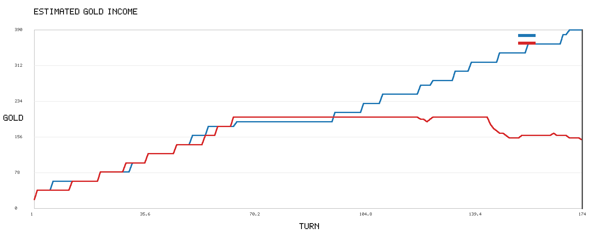
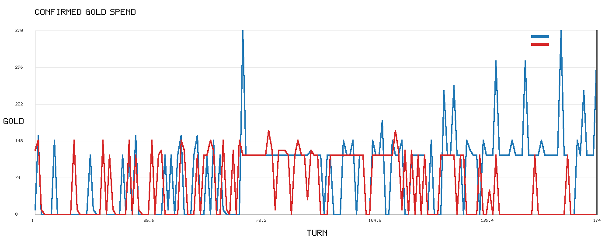
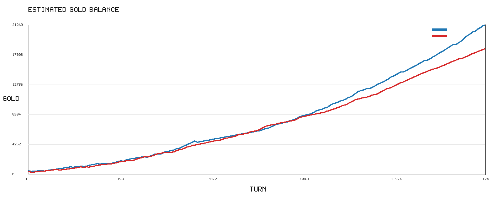
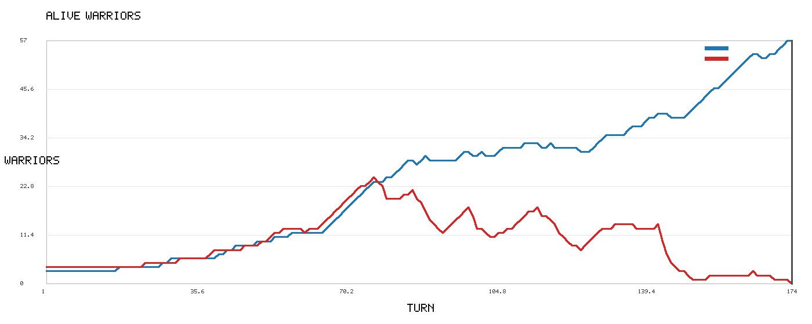
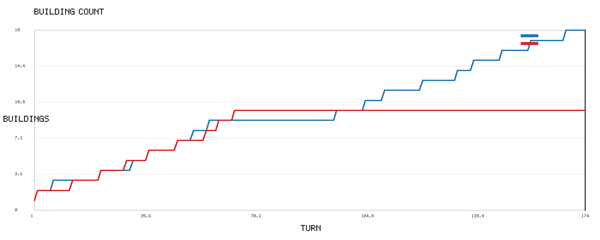
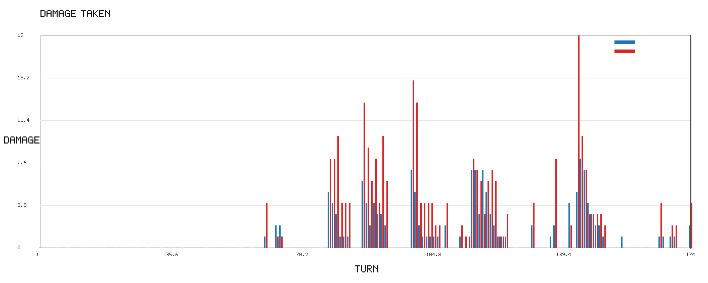
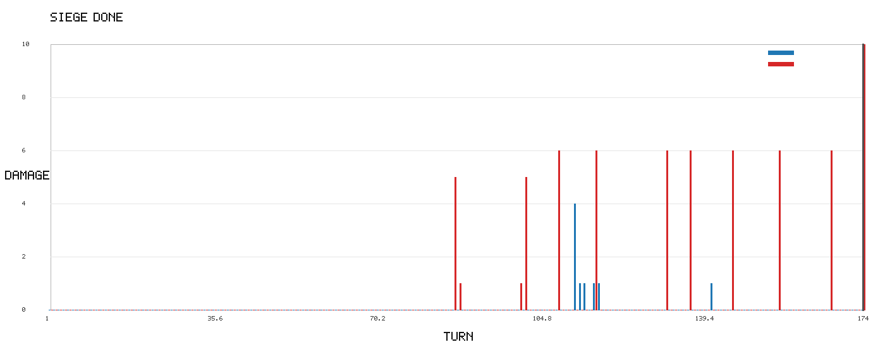
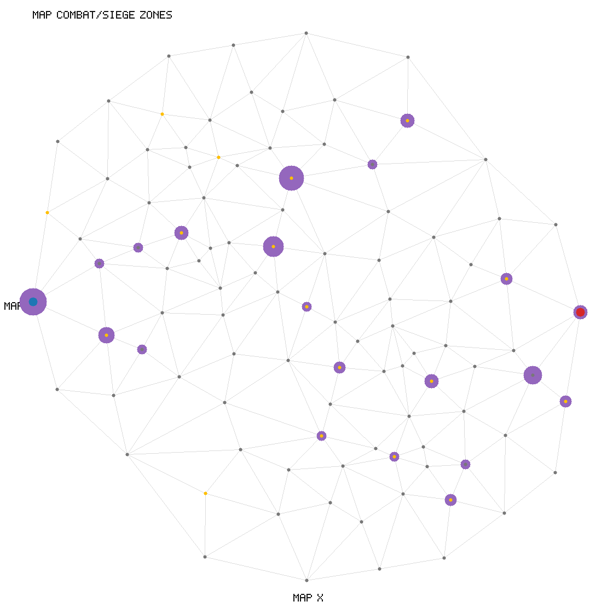
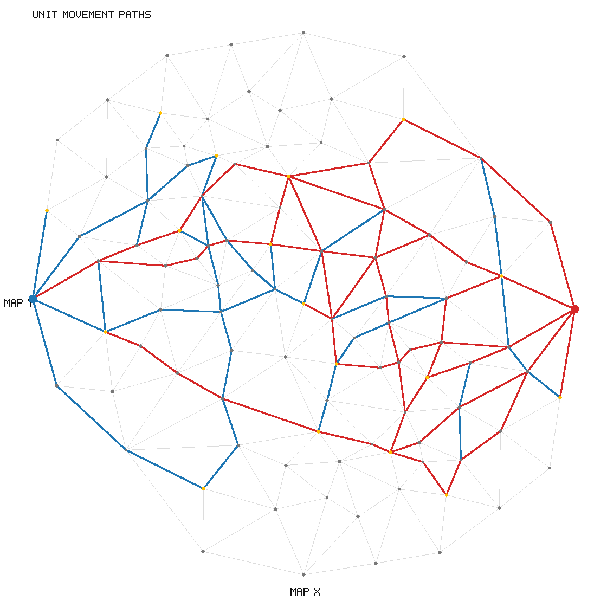

# NEXT NATION Single Game Analysis

## Summary

- Validation: `VALID`
- Winner: `A`
- End turn: `174`
- Result: `RESULT LEFT_WIN HQ_DESTROYED`
- Main factor: `ARMY_GAP`
- Confidence: `0.9`
- Decisive turn range: `169-179`

A side가 B side 대비 ARMY_GAP 흐름에서 앞섰습니다. 근거: 병력 수 격차: 57.0.

## A Side vs B Side Counts

- Commands: `{'A': {'MOVE': 461, 'UPGRADE': 20, 'TRAIN': 83}, 'B': {'MOVE': 162, 'TRAIN': 67, 'UPGRADE': 9}}`
- Events: `{'A': {'TIME': 174, 'MOVE': 1693, 'UPGRADE': 20, 'TRAIN': 83, 'DAMAGE': 91, 'SIEGE': 6}, 'B': {'TIME': 174, 'TRAIN': 67, 'MOVE': 668, 'UPGRADE': 9, 'DAMAGE': 126, 'SIEGE': 12}}`
- First turns: `{'A': {'TRAIN': 18, 'MOVE': 1, 'UPGRADE': 2, 'SIEGE': 113, 'COMBAT': 61, 'TIME': 1, 'DAMAGE': 61}, 'B': {'TRAIN': 1, 'MOVE': 1, 'UPGRADE': 2, 'SIEGE': 87, 'COMBAT': 61, 'TIME': 1, 'DAMAGE': 61}}`

## Buildup Timeline

- Turn 1 `A` `MOVE`: A side MOVE A2 1
- Turn 1 `B` `MOVE`: B side MOVE B2 93
- Turn 1 `B` `TRAIN`: B side TRAIN 1
- Turn 2 `A` `MOVE`: A side MOVE A3 7
- Turn 2 `A` `UPGRADE`: A side UPGRADE 1
- Turn 2 `B` `UPGRADE`: B side UPGRADE 93
- Turn 3 `B` `MOVE`: B side MOVE B3 99
- Turn 3 `B` `MOVE`: B side MOVE B4 93
- Turn 7 `A` `UPGRADE`: A side UPGRADE 7
- Turn 13 `B` `UPGRADE`: B side UPGRADE 99
- Turn 14 `B` `MOVE`: B side MOVE B4 82
- Turn 18 `A` `TRAIN`: A side TRAIN 1
- Turn 19 `A` `MOVE`: A side MOVE A4 18
- Turn 22 `A` `UPGRADE`: A side UPGRADE 18
- Turn 22 `B` `UPGRADE`: B side UPGRADE 82
- Turn 24 `B` `TRAIN`: B side TRAIN 1
- Turn 25 `B` `MOVE`: B side MOVE B5 85
- Turn 28 `A` `TRAIN`: A side TRAIN 1
- Turn 29 `A` `MOVE`: A side MOVE A5 36
- Turn 30 `A` `TRAIN`: A side TRAIN 1
- Turn 30 `B` `UPGRADE`: B side UPGRADE 85
- Turn 174 `A` `CRITICAL_TURN`: 병력/건물 격차가 크게 벌어진 후보 턴

## Loss Reasons

- `LOW_TRAINING_VOLUME` (0.68): 패배 진영 훈련 이벤트가 더 적음

## Charts

## Assumptions

- 골드와 HP는 로그 이벤트 기반 추정값입니다.
