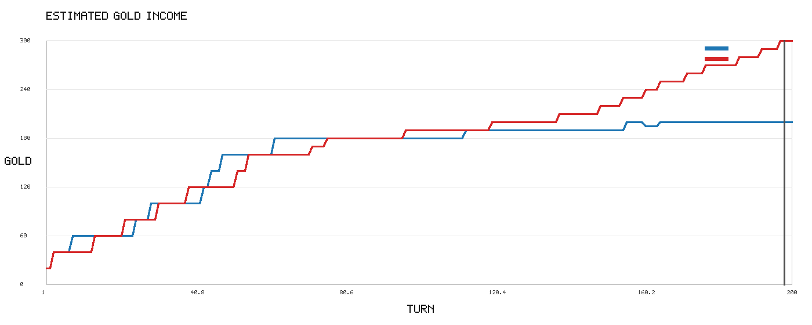
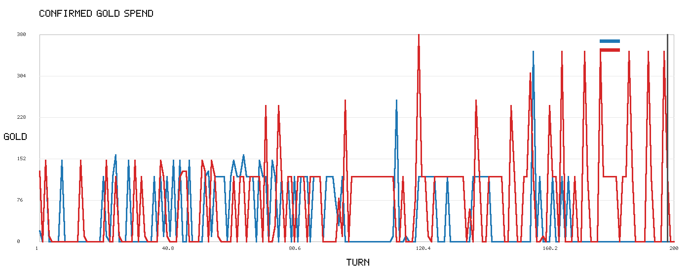
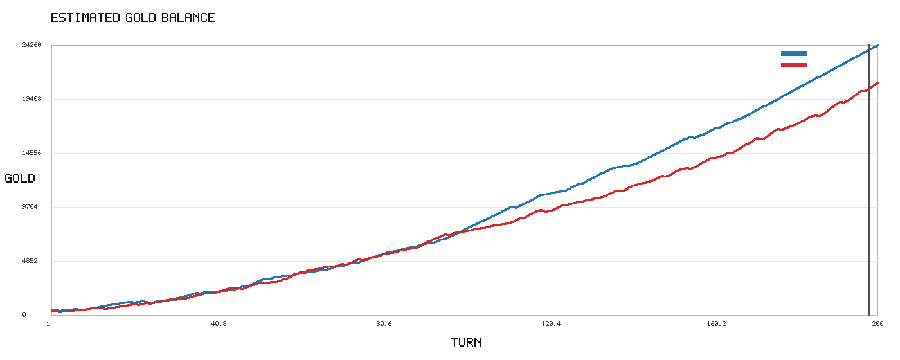
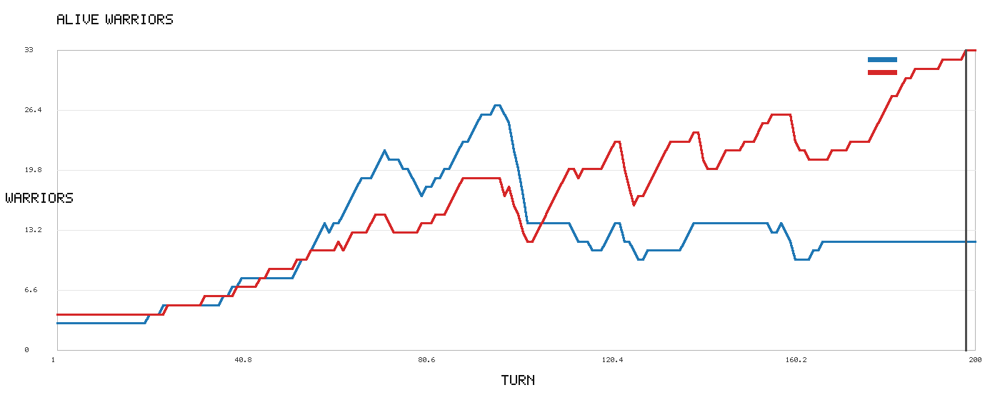
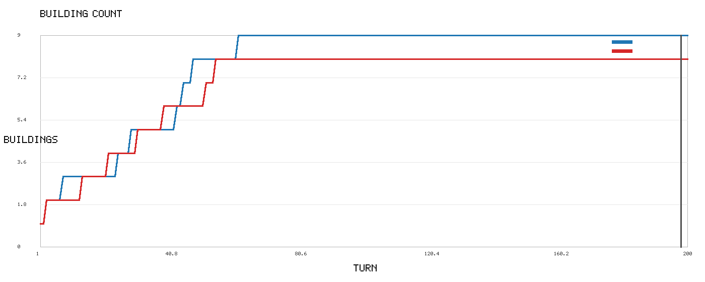
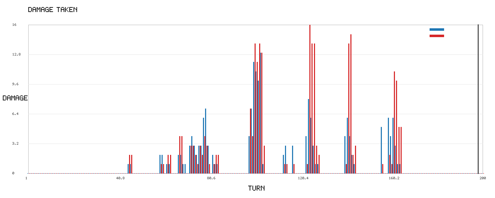
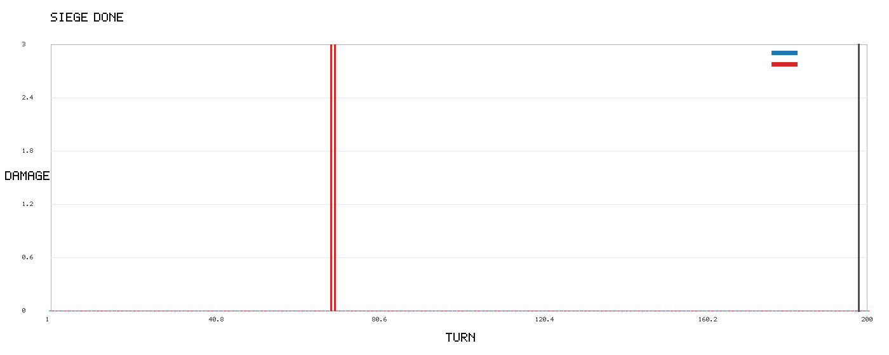
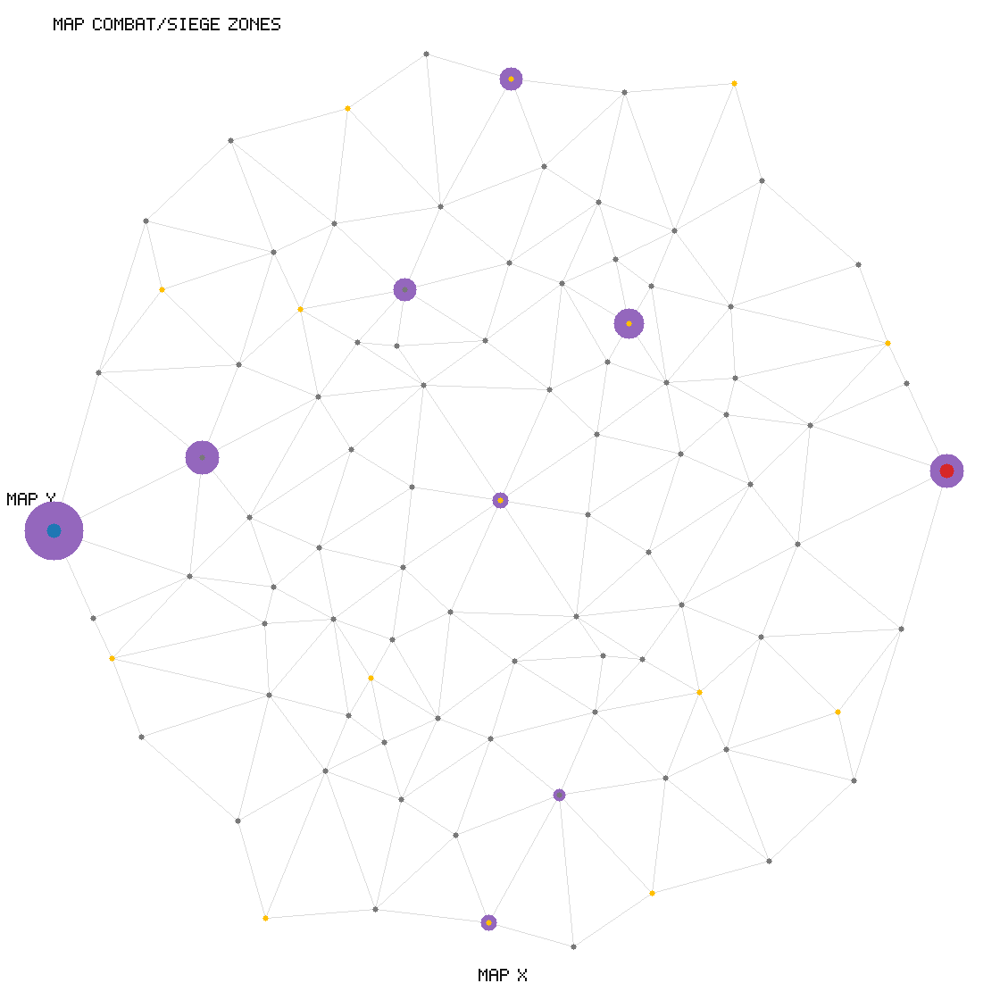
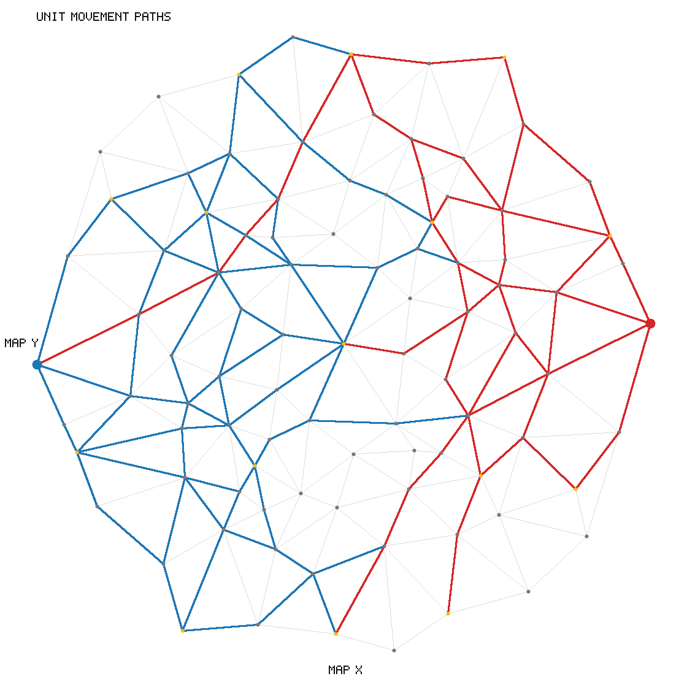

# NEXT NATION Single Game Analysis

## Summary

- Validation: `VALID`
- Winner: `unknown`
- End turn: `200`
- Result: `RESULT DRAW TURN_LIMIT`
- Main factor: `UNCONVERTED_ADVANTAGE`
- Confidence: `0.72`
- Decisive turn range: `193-203`

무승부지만 B side가 승리로 전환할 여지가 있었습니다. 놓친 핵심 요인은 UNCONVERTED_ADVANTAGE입니다. 근거: B side가 병력/건물/골드 우위를 승리 조건으로 전환하지 못함.

## A Side vs B Side Counts

- Commands: `{'A': {'MOVE': 243, 'UPGRADE': 10, 'TRAIN': 53}, 'B': {'MOVE': 169, 'TRAIN': 78, 'UPGRADE': 21}}`
- Events: `{'A': {'TIME': 200, 'MOVE': 958, 'UPGRADE': 10, 'TRAIN': 53, 'DAMAGE': 108}, 'B': {'TIME': 200, 'TRAIN': 78, 'MOVE': 969, 'UPGRADE': 21, 'DAMAGE': 104, 'SIEGE': 2}}`
- First turns: `{'A': {'TRAIN': 21, 'MOVE': 1, 'UPGRADE': 3, 'SIEGE': None, 'COMBAT': 45, 'TIME': 1, 'DAMAGE': 45}, 'B': {'TRAIN': 1, 'MOVE': 1, 'UPGRADE': 3, 'SIEGE': 69, 'COMBAT': 45, 'TIME': 1, 'DAMAGE': 45}}`

## Buildup Timeline

- Turn 1 `A` `MOVE`: A side MOVE A2 2
- Turn 1 `A` `MOVE`: A side MOVE A3 6
- Turn 1 `B` `MOVE`: B side MOVE B2 90
- Turn 1 `B` `TRAIN`: B side TRAIN 1
- Turn 3 `A` `UPGRADE`: A side UPGRADE 2
- Turn 3 `B` `UPGRADE`: B side UPGRADE 90
- Turn 4 `B` `MOVE`: B side MOVE B3 86
- Turn 4 `B` `MOVE`: B side MOVE B4 90
- Turn 8 `A` `UPGRADE`: A side UPGRADE 6
- Turn 14 `B` `UPGRADE`: B side UPGRADE 86
- Turn 15 `B` `MOVE`: B side MOVE B4 74
- Turn 21 `A` `TRAIN`: A side TRAIN 1
- Turn 22 `A` `MOVE`: A side MOVE A4 18
- Turn 22 `B` `UPGRADE`: B side UPGRADE 74
- Turn 24 `A` `TRAIN`: A side TRAIN 1
- Turn 25 `A` `MOVE`: A side MOVE A5 27
- Turn 25 `A` `UPGRADE`: A side UPGRADE 18
- Turn 25 `B` `TRAIN`: B side TRAIN 1
- Turn 26 `B` `MOVE`: B side MOVE B5 65
- Turn 29 `A` `UPGRADE`: A side UPGRADE 27
- Turn 198 `B` `CRITICAL_TURN`: 병력/건물 격차가 크게 벌어진 후보 턴

## Loss Reasons

## Charts

## Assumptions

- 골드와 HP는 로그 이벤트 기반 추정값입니다.
