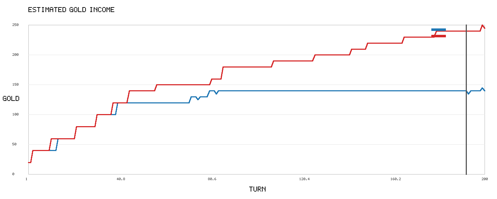
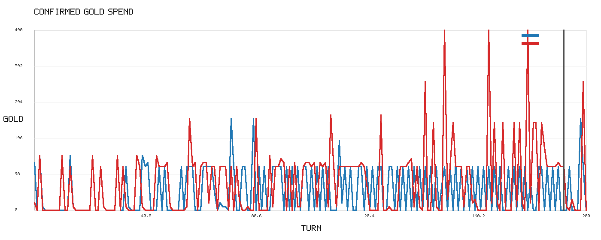
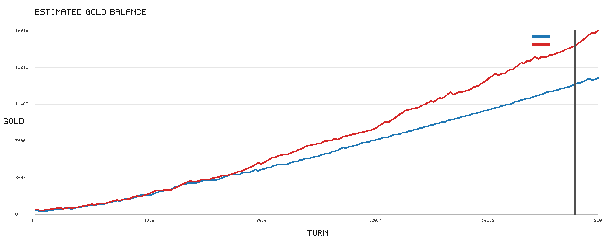
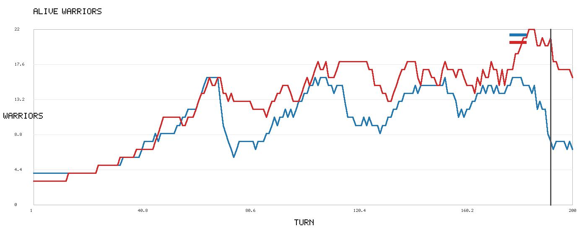
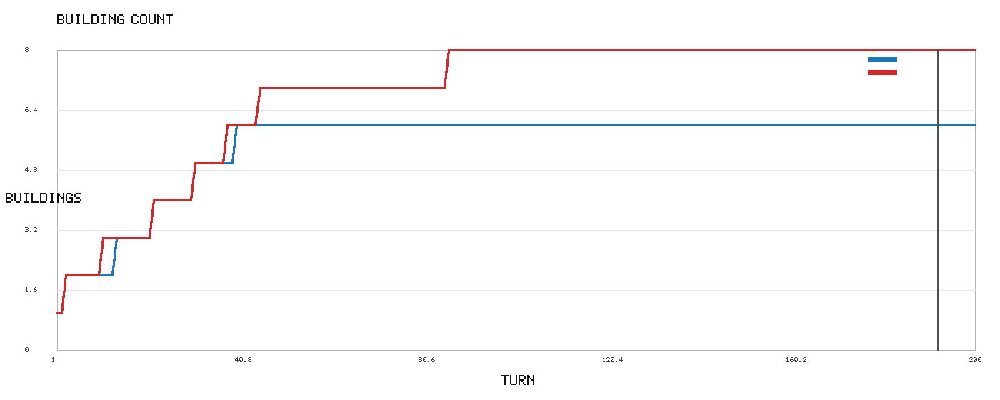
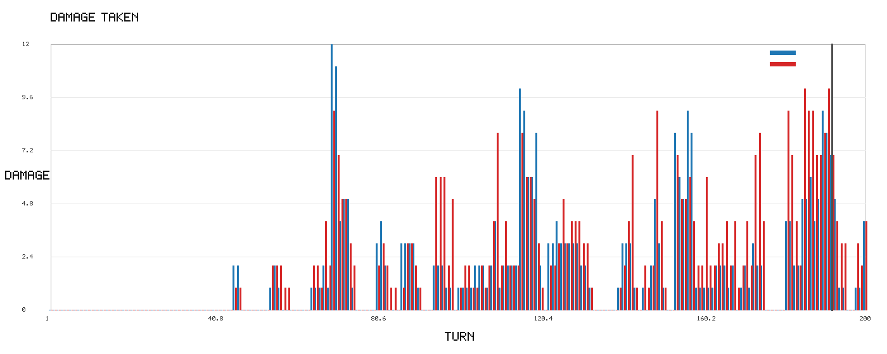
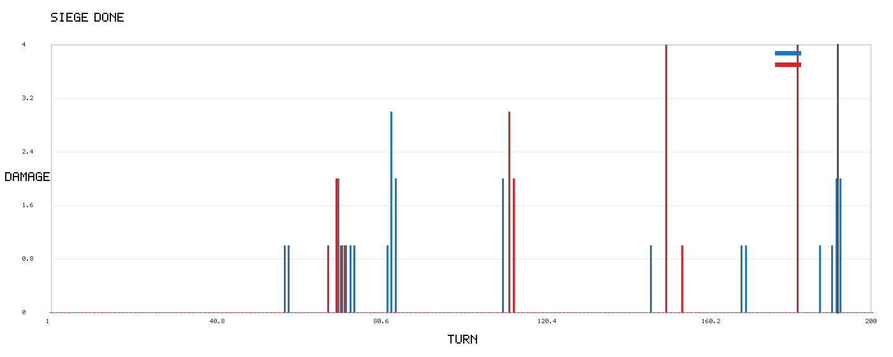
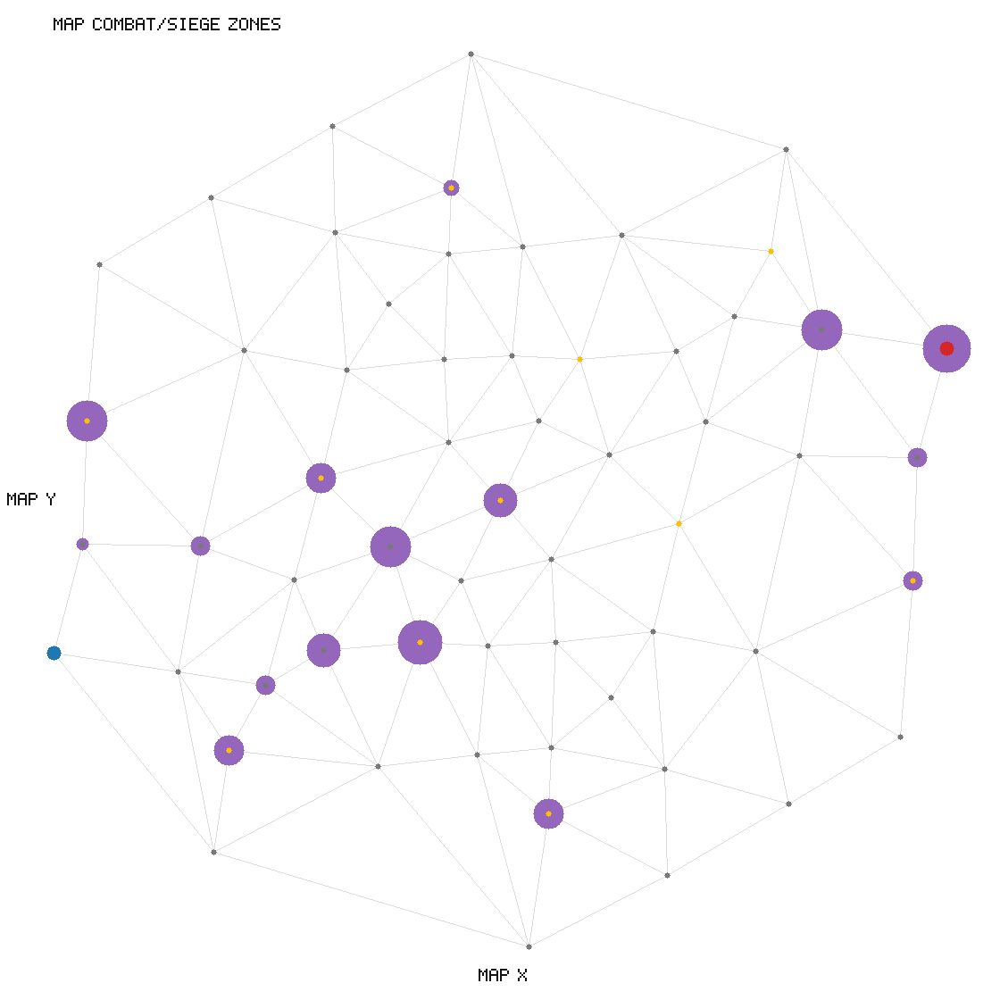
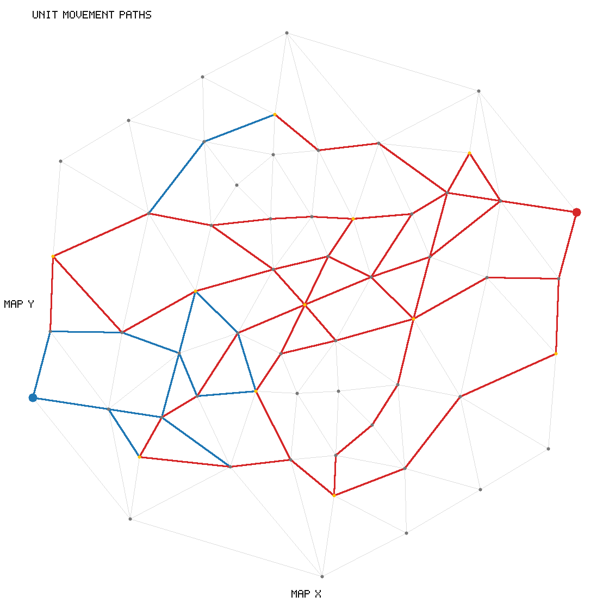

# NEXT NATION Single Game Analysis

## Summary

- Validation: `VALID`
- Winner: `B`
- End turn: `200`
- Result: `RESULT RIGHT_WIN TURN_LIMIT`
- Main factor: `ARMY_GAP`
- Confidence: `0.9`
- Decisive turn range: `187-197`

B side가 A side 대비 ARMY_GAP 흐름에서 앞섰습니다. 근거: 병력 수 격차: 9.0.

## A Side vs B Side Counts

- Commands: `{'A': {'MOVE': 179, 'TRAIN': 74, 'UPGRADE': 8}, 'B': {'MOVE': 158, 'UPGRADE': 16, 'TRAIN': 77}}`
- Events: `{'A': {'TIME': 200, 'TRAIN': 74, 'MOVE': 602, 'UPGRADE': 8, 'DAMAGE': 232, 'SIEGE': 18}, 'B': {'TIME': 200, 'MOVE': 652, 'UPGRADE': 16, 'TRAIN': 89, 'DAMAGE': 276, 'SIEGE': 9}}`
- First turns: `{'A': {'TRAIN': 1, 'MOVE': 1, 'UPGRADE': 3, 'SIEGE': 58, 'COMBAT': 46, 'TIME': 1, 'DAMAGE': 46}, 'B': {'TRAIN': 14, 'MOVE': 1, 'UPGRADE': 3, 'SIEGE': 68, 'COMBAT': 46, 'TIME': 1, 'DAMAGE': 46}}`

## Buildup Timeline

- Turn 1 `A` `MOVE`: A side MOVE A2 8
- Turn 1 `A` `TRAIN`: A side TRAIN 1
- Turn 1 `B` `MOVE`: B side MOVE B2 50
- Turn 1 `B` `MOVE`: B side MOVE B3 57
- Turn 3 `A` `UPGRADE`: A side UPGRADE 8
- Turn 3 `B` `UPGRADE`: B side UPGRADE 50
- Turn 4 `A` `MOVE`: A side MOVE A3 1
- Turn 4 `A` `MOVE`: A side MOVE A4 8
- Turn 11 `B` `UPGRADE`: B side UPGRADE 57
- Turn 14 `A` `UPGRADE`: A side UPGRADE 1
- Turn 14 `B` `TRAIN`: B side TRAIN 1
- Turn 15 `A` `MOVE`: A side MOVE A4 13
- Turn 15 `B` `MOVE`: B side MOVE B4 45
- Turn 22 `A` `UPGRADE`: A side UPGRADE 13
- Turn 22 `B` `UPGRADE`: B side UPGRADE 45
- Turn 25 `A` `TRAIN`: A side TRAIN 1
- Turn 25 `B` `TRAIN`: B side TRAIN 1
- Turn 26 `A` `MOVE`: A side MOVE A5 21
- Turn 26 `B` `MOVE`: B side MOVE B5 29
- Turn 31 `A` `UPGRADE`: A side UPGRADE 21
- Turn 31 `B` `UPGRADE`: B side UPGRADE 29
- Turn 192 `B` `CRITICAL_TURN`: 병력/건물 격차가 크게 벌어진 후보 턴

## Loss Reasons

- `LOW_TRAINING_VOLUME` (0.68): 패배 진영 훈련 이벤트가 더 적음

## Charts

## Assumptions

- 골드와 HP는 로그 이벤트 기반 추정값입니다.
