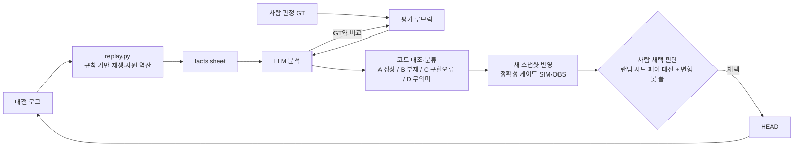

# NYPC 2026 — NEXT NATION AI Bot

턴제 전략 게임 **NEXT NATION**(NYPC 2026 예선)용 AI 봇과,
봇 개선을 위한 **LLM 기반 대전 로그 분석·반영 파이프라인**을 담은 저장소입니다.

**결과**: 예선 22위 · 실전 대전 104경기 분석·반영

---

## 핵심: 사람 판정(GT)에 맞춘 LLM 분석 하네스

한 경기는 200턴 동안 양측의 모든 명령·이동·전투가 기록된 로그로 남습니다.
봇을 개선하려면 이 로그에서 패배 요인을 찾아야 하는데, 사람이 모두 읽기에는 양이 많았습니다.
그래서 **LLM이 사람과 같은 기준으로 로그를 판정하도록 하네스를 만들고, 그 판정을 봇 코드에 반영하는 루프**를 구성했습니다.

### 1. GT 구축
대전 로그를 직접 분석해 패배 요인과 손해 오더를 판정한 문서를 작성하고, 이를 평가 기준(GT)으로 사용했습니다.

### 2. 근거 데이터 생성 — `replay.py`
LLM이 로그를 추측으로 해석하지 않도록, 로그를 재생해 병력·위치·궤적·전투 기록을 정리하고
상대 자원은 게임 규칙으로 역산했습니다. 역산 결과는 로그의 HUNGER(자원 부족) 기록과 대조해 검증합니다.

### 3. LLM 분석 하네스
분석 루브릭과 단계별 스킬(Claude Code)로 LLM이 GT와 같은 판정을 내리도록 구성했습니다.
LLM 분석을 GT와 비교해 놓친 관점이 있으면 루브릭에 일반화된 평가 기준으로 추가합니다.
상대 봇의 효과적인 행동을 우리 기능 후보로 뽑아내는 단계도 포함합니다.

| 스킬 | 역할 |
|---|---|
| `/analyze-logs` | 로그 → 승패 요인 분석 문서 |
| `/analyze-logs-deep` | 봇 스냅샷 코드와 대조한 심층 분석 |
| `/reflect-analysis` | 분석 결과를 코드 기준으로 분류해 새 스냅샷에 반영 |
| `/analyze-reflect` | 분석 → 반영 일체형 |
| `/analyze-reflect-deep` | 심층 분석 → 반영 일체형 |

### 4. 반영과 채택의 분리
LLM이 수정 사항의 채택까지 결정하면 특정 상대에 과적합되는 문제가 있어,
자동화는 **정확성 게이트(SIM_TEST / OBS_TEST)까지**로 제한했습니다.
최종 채택은 랜덤 시드 페어 대전과 성향이 다른 변형 봇 풀(rush / greed / turtle / harass) 결과를 보고 사람이 판단합니다.

---

## 봇 구조
스타크래프트 AI 봇 구조를 참고한 모듈형 매니저 구조입니다.

- **StrategyManager** — 포워드 시뮬레이터 기반 K-day 롤아웃으로 정책 후보 평가
- **EconomyManager** — 확장·건설·생산
- **MovementManager** — 경로·집결
- **MilitaryManager** — 방어·공성·교전

---

## 폴더 구성
| 경로 | 내용 |
|---|---|
| `Qualifying/submission/` | 봇 스냅샷 (`MMDDHHmm.cpp`, 분석 반영본은 `r`/`d` 접미) |
| `Qualifying/legacy/log-pipeline/` | 분석 정책(POLICY.md), `tools/replay.py` |
| `Qualifying/legacy/skills/` | LLM 분석·반영 스킬 정의 |
| `Qualifying/Logs/Reflected/` | 반영 완료된 대전 로그와 분석 문서 |
| `Qualifying/Param-Tuned/` | 파라미터 튜닝 버전과 기록 |

## 사용 도구
C++ · Python · Claude Code (Skills) · PowerShell (대전 하네스)
